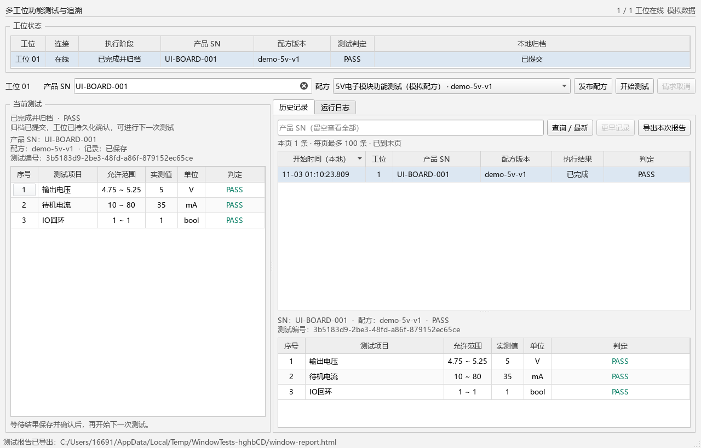
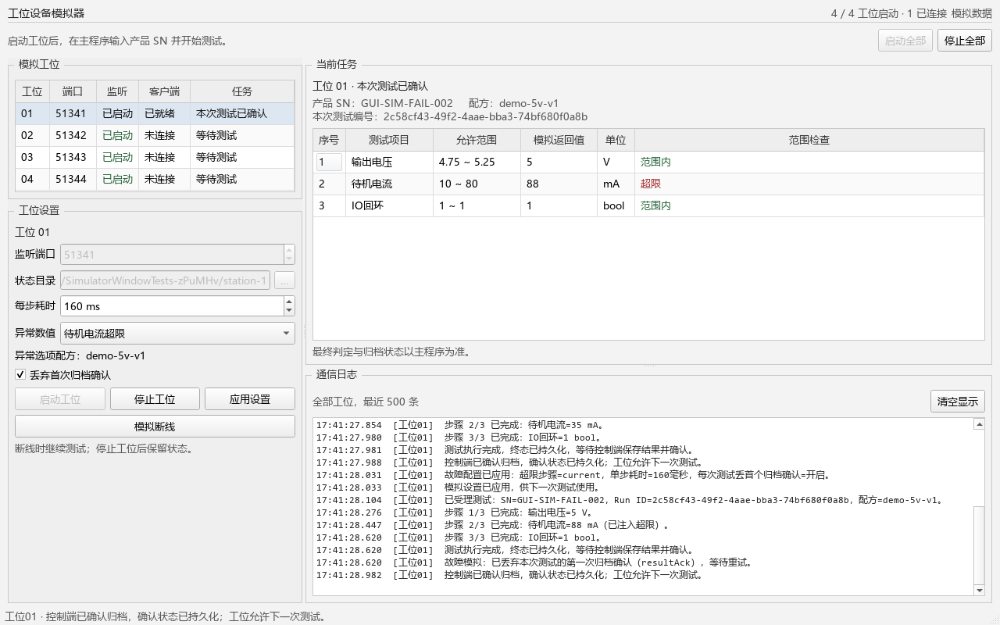

# StationTestWorkbench

**电子模块多工位功能测试与质量追溯工作台**，Qt 6 Widgets / C++17 / TCP / SQLite。

这是独立项目，源码位于 `D:\demoqt6\StationTestWorkbench`。它从 TCP 设备监控进一步转向“产品测试流程”：对一个 SN 使用一个确定的配方版本，执行有起点和终点的测试，分开处理命令受理、执行终态、质量判定、归档提交和工位确认。

目前是可运行、可测试的模拟工位版本。电压、电流、IO 数值由模拟器生成；默认限值是演示配方，不是产品检验标准，也没有宣称完成真实电气测量。



主程序和模拟器均使用简洁的浅灰白工具界面。工位状态、测试步骤、记录查询和日志按功能排列；测试编号放在选中详情中，表格优先显示日常操作信息。

## 直接运行

主程序和模拟器默认独立启动，分别关闭，互不启动或结束对方。

- 桌面“多工位功能测试与追溯”或便携包内的 `启动主程序.cmd`：只打开主程序。没有启动模拟器时，工位显示未连接；随后启动模拟工位，主程序会自动尝试连接。
- 桌面“多工位设备模拟器”：只打开图形模拟器，点击“启动全部”开始监听。便携包也可以直接双击 `StationSimulator.exe`，其默认数据目录见下文。

主程序的独立启动入口继续使用原来的 `demo-data/client`，保留已有记录；桌面模拟器继续使用 `demo-data/station-N`。默认 TCP 端口为46501～46504。开发目录需要先构建，再使用 `启动主程序.cmd`。

可选的 `启动演示.cmd` 是明确的联合演示入口：同时打开一个**Qt 图形工位模拟器面板**和一个客户端，退出客户端时关闭本次脚本启动的模拟器。日常分别启动使用前面的两个入口，不要同时运行联合演示以免端口和数据库冲突。模拟器的网络、计时器与状态文件在专用工作线程处理。

桌面模拟器及联合演示的默认演示行为如下（直接双击裸模拟器默认全部正常）：

- 工位 1、2：正常值，预期 PASS。
- 工位 3：电流超限，预期 FAIL。
- 工位 4：丢弃第一次归档 ACK，观察自动重试；事务提交后要等工位确认才能再次开始。

在工位表中选一个工位，输入产品 SN，选择配方，点击“开始测试”。步骤表逐步更新，最终显示判定和归档状态。取消需要等待工位返回取消终态，不会把按钮点击直接当成停止成功。历史查询使用**完整 SN 精确匹配**，留空查询全部；每页最多 100 条，采用 ID 游标翻页。选中历史记录可导出 HTML 测试报告，包含配方快照哈希、限值、步骤和未执行项；生成文件和查询均在数据库线程执行。

以下参数示例属于可选联合演示脚本。如果脚本提示端口占用，关闭先前演示，或使用其他端口：

```powershell
powershell -NoProfile -ExecutionPolicy Bypass -File .\scripts\start-demo.ps1 -BasePort 47501
```

关闭故障注入、只开两个正常工位：

```powershell
powershell -NoProfile -ExecutionPolicy Bypass -File .\scripts\start-demo.ps1 -Stations 2 -FailStation 0
```

联合脚本可通过 `-DataDirectory 'D:\StationDemoData'` 指定演示数据根目录，客户端放在其 `client` 子目录；`start-client.ps1` 的同名参数则直接指定客户端数据目录。不要让两个客户端使用同一个目录同时运行；当前版本按单客户端控制设计。模拟器只监听本机回环地址。

## 图形模拟器怎么用



双击 `StationSimulator.exe` 打开四工位面板，点击“启动全部”后等待主程序连接。该图形入口默认将状态保存到 Qt 的 `AppLocalDataLocation`（本机应用数据目录）下的 `station-N`；桌面模拟器传入 `--data-dir ...\demo-data`，延续原联合演示的状态目录，并保留工位3电流超限、工位4丢弃首次归档确认的演示设置。需要在便携包中使用相同设置，可以运行：

```powershell
.\StationSimulator.exe --stations 4 --port 46501 --data-dir .\demo-data --step-ms 400 --fail-station 3 --demo-faults
```

主程序选工位、输入产品 SN 和配方后开始测试；模拟器显示接收的任务、逐项生成值、结果确认与连接变化。单独模拟器入口不会启动操作员主程序；希望同时打开两者时使用 `启动演示.cmd`，不要重复启动同一组端口。

主程序选中工位和配方后，会通过TCP同步只读配方预览；模拟器“异常数值”下拉框按该配方的步骤名称自动生成选项，新项目在第一次测试前即可选择，无需先跑一次正常测试。每个工位保留各自的预览，断线重连后重新同步。异常选项下方显示配方版本；实际任务表仍显示本次/上次测试的原始配方和结果。

选中工位可以修改单步耗时、注入超限项目、勾选“丢弃首次归档确认”，并应用设置。执行中和终态未确认时禁止改动故障配置，防止同一次测试中途改变规则；此时选中新配方只缓存预览，结算后再更新异常选项。若原异常步骤不在新配方中，会明确标记“当前配方未包含”，需要重新选择并应用，避免界面与实际故障设置不一致。“断开客户端”只切断网络，工位仍继续模拟执行，供主程序重连核对；“停止工位”则停止监听和执行，保留状态文件，下次启动按中断恢复，不能当作正常完成。

数值全部由程序生成，步骤表中的范围来自本次任务绑定的配方。日志仅保留最近500条，帮助观察启动、握手、步骤、重连与归档确认。

自动化或需要四个独立进程时，使用：

```powershell
powershell -NoProfile -ExecutionPolicy Bypass -File .\scripts\start-demo.ps1 -HeadlessSimulators
.\StationSimulator.exe --headless --station-id 1 --port 46501 --data-dir D:\StationDemoData\station-1
```

图形面板支持 `--stations 4 --port 46501 --data-dir D:\StationDemoData --auto-start`。显式指定 `--station-id 1` 时只显示该工位，`--data-dir`直接作为该工位状态目录；多工位模式自动使用目录下的`station-N`。`--smoke-exit-ms`仅用于部署验证自动关闭。

## 构建与验证

用 Qt Creator 打开根目录 `CMakeLists.txt`，选择 Qt 6 MinGW 64 位套件。需要 Qt Core、Network、Sql、Widgets；测试另外需要 Qt Test。已验证环境：Windows x64，Qt 6.10.3，MinGW 13.1.0，CMake / Ninja。

构建后有两个程序：

| 程序 | 用途 |
|---|---|
| `StationTestWorkbench.exe` | 操作员界面、网络引擎、数据库和日志后台 |
| `StationSimulator.exe` | Qt 图形模拟器，管理1～4个 TCP 工位；支持 `--headless` 单工位后台模式 |

自动构建和测试：

```powershell
powershell -NoProfile -ExecutionPolicy Bypass -File .\scripts\verify.ps1 -BatchRuns 1000
```

脚本里的工具路径可通过参数覆盖，不修改系统 PATH。测试结果在 `build/quality/*-results.txt` 和 `test-results.xml`。测试使用临时目录和本机 TCP，不写入演示或原项目的数据。

10万轮次历史数据的独立性能测量：

```powershell
powershell -NoProfile -ExecutionPolicy Bypass -File .\scripts\benchmark.ps1 -Rows 100000
```

基准临时生成10万运行、30万步骤，测量200次完整SN查询和100次百行游标查询。报告包含P50/P95、主事件循环间隔和进程内存；数据准备采用批量SQL，不作为生产写入性能。

生成包含 Qt 运行库的便携包：

```powershell
powershell -NoProfile -ExecutionPolicy Bypass -File .\scripts\package.ps1
```

产物位于 `dist/StationTestWorkbench-0.1.0-win64.zip`。这是解压运行的便携包。当前提交不修改原 TCP、温湿度程序或它们的安装包。

## 工程上实际实现了什么

1. **先留测试身份，再发动作。** 创建 UUID runId，绑定 SN、工位、配方内容及版本；数据库预约成功后才发送 start。同一个未结算 SN 无法在两个工位同时执行，复测使用新的 runId。
2. **命令受理与质量结果分开。** accepted 只说明工位受理；completed 才表示执行结束；PASS/FAIL 由本地根据该次测试保存的配方限值计算。
3. **终态事务与确认闭环。** 结果、各步骤、判定和运行终态在一个 SQLite 事务中提交；提交成功才发 resultAck，工位持久化确认后回复 resultConfirmed。确认前阻止下一次测试。
4. **重复结果幂等、冲突结果拒绝。** runId 是唯一键；相同测量终态不增加记录，不同内容不覆盖已有结果。协议 CRC 用于传输错误检测，不作为身份认证。
5. **断线后查询已有测试。** TCP 会话和测试身份分开；重连后按 runId 查询，保持原身份，不盲目重发 start。客户端重启保留待核对的 SN / 工位占用；模拟器执行中重启明确返回未知，不伪造 PASS。
6. **后台线程和有界资源。** GUI 只处理模型与交互；网络、SQLite、日志文件各有自己的工作线程。接收、发送、待存结果、日志和历史页均有限额，保存失败保留占用并重试。
7. **可复现故障验证。** 真实 SQLite 写锁、插入失败回滚、错序/错误身份、重复终态、ACK 丢失、客户端恢复和独立工位进程均有测试。

对应结构和取舍见 [架构与协议](docs/ARCHITECTURE.md)，实测数据和未验证边界见 [验证记录](docs/VALIDATION.md)。

2026-11-02验证记录包含自动化用例、1000次测试归档全量核对、四独立工位进程、10万轮次历史性能及隔离PATH便携包启动。具体结果见验证记录；模拟器测试和实物测量证据分开记录。

## 配方版本

内置 `demo-5v-v1` 包含输出电压、待机电流、IO 回环。使用“发布配方”选择 `recipes/demo-5v-v2.json` 可以发布示例新版本。

验证动态异常选项可发布 `recipes/demo-5v-startup-v1.json`：在主程序选择该配方及工位后，模拟器选中同一工位，下拉会新增“启动耗时超限”。选中它并“应用设置”，再输入SN开始测试，启动耗时将生成超出500ms上限的演示数值并判FAIL；这些数值由模拟器生成。

每个步骤有 `id`、`label`、`unit`、`min`、`max`、`nominal`：`min/max` 是包含端点的判定范围；`nominal` 仅供模拟器生成正常示例值。步骤顺序参与测试契约。运行保存完整快照，历史结果不跟随后来配方变化。

同版本同内容重复发布为幂等操作；同版本不同内容拒绝。要改限值必须发布新版本。最多 16 步，数值必须有限，必须满足 `min <= nominal <= max`。

## 文件与数据

```text
src/core         配方、身份校验、本地质量判定
src/protocol     有界组帧、CRC、拆包与重同步
src/runtime      控制器、网络测试状态机、异步日志
src/storage      独立线程 SQLite 连接、事务、恢复与游标查询
src/ui           QAbstractTableModel / 代理 / Widgets 界面
src/simulator    图形模拟器、专用工位线程、后台模式与持久化待确认结果
tests            协议、领域、存储、模型、日志、流程、窗口、进程测试
scripts          构建验证、演示启动、便携包生成
```

`启动主程序.cmd`、桌面主程序快捷方式和联合演示脚本使用相同的 `demo-data/client/data/workbench.db` 保存配方、测试身份、测量值、判定与追溯记录；`demo-data/client/logs/workbench.log` 保存运行日志，单文件约 5 MiB，保留 9 份归档；`demo-data/station-N/station-N.json` 保存对应模拟器的当前/最近一次执行和待确认终态。

直接运行客户端时，默认使用 Qt 的 AppDataLocation；`--data-dir` 可覆盖。运行目录、数据库、日志、构建产物和常见密钥文件已放入 `.gitignore`。这里不需要任何云密钥或 GitHub token。

## 与温湿度项目的组合

温湿度项目用于说明真实串口 RTU 接线采集、连续时序数据、曲线和监测告警。本项目用于说明多工位 TCP 控制、有限测试流程、产品身份、版本化配方、质量终态和追溯一致性。

本项目通信及日志的一部分设计借鉴了原 TCP 项目；原项目保留。面试时应展示能复现的故障和测试证据，并能解释代码。尚未接入实际测试仪器、PLC 或治具，尚无长期现场运行、真实干扰和断电耐久证据，不应把模拟测试描述成工业交付经历。
