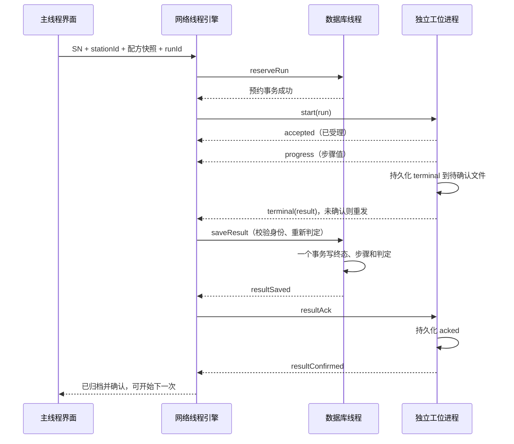

# 架构与协议

## 目录与依赖

本工程沿用温湿度项目 `Qwenshiducaiji` 的目录风格：源码平铺在根目录，测试平铺在 `tests/`，由根 `CMakeLists.txt` 统一定义运行逻辑库 `WorkbenchRuntime`、界面库 `WorkbenchWidgets`、入口和测试。模拟器位于同级独立工程 `D:\demoqt6\StationSimulator`；各自的默认构建和测试互不依赖。完整目录和修改导航见 [目录与业务职责](PROJECT_STRUCTURE.md)。

`StationEndpoint` 属于测试业务，`TestEngine` 通过它接收连接配置，不引用工作台控制器。`WorkbenchController` 统一连接测试引擎、追溯存储和异步日志；这些类归入 `WorkbenchRuntime`，网络、数据库及日志分别拥有自己的工作线程。模拟工位的配置、设备线程和窗口由另一工程自行维护。

通信协议和日志实现只使用 Qt Core；运行逻辑库统一链接 Core、Network、Sql。主窗口、模型和样式归入 `WorkbenchWidgets`，依赖运行逻辑库及 Widgets。模拟器拥有自己的配方契约、协议和样式实现，使用独立命名空间；在线 STW2 格式保持一致。只有显式启用的跨项目测试会导入模拟器目标。两个工程分别输出程序、验证报告和便携包。

## 一次测试按什么顺序执行

接收到测试终态后，即使界面显示 PASS，`stored=false` 仍意味着尚未提交事务。`stored=true` 后也可能短暂等待 `resultConfirmed`，因此按钮由 `canStart` 控制，不能只按 PASS 启用。

数据库写锁会导致事务失败；引擎保留终态，每秒重试，不确认、不释放工位。普通日志允许在过载时计数丢弃，测试终态不使用这种丢弃策略。

## 线程与对象生命周期

| 位置 | 负责的对象 | 所有权及退出 |
|---|---|---|
| GUI 主线程 | MainWindow、各模型、WorkbenchController | 更新显示与排队请求；窗口关闭前控制器停止工作线程 |
| 网络线程 | TestEngine、各 QTcpSocket、计时器、Parser | 在线程启动后创建 socket；停止 timer/socket 后退出 |
| 数据库线程 | Repository、唯一 QSqlDatabase 连接 | 连接只在归属线程创建、访问、关闭和移除 |
| 日志线程 | LogFileWorker | 文件创建、写入、轮转和 flush 均在该线程 |
| 独立模拟器 GUI 主线程（另一工程） | SimulatorWindow、工位表、步骤表和有界日志 | 排队下发控制，快照按值返回；无网络或状态文件I/O |
| 独立模拟器工作线程（另一工程） | SimulatorWorker、StationServer、socket、计时器、QSaveFile | 线程内创建和销毁；小状态文件原子替换；后台模式为单独QCoreApplication进程 |

信号/槽跨线程使用 Qt 排队连接，JSON 值按值传递。退出先停止网络接入，再排空已进入数据库队列的工作，最后排空文件日志；不使用 `QThread::terminate`。退出等待只发生在关闭流程，运行时查询和日志 I/O 不阻塞 GUI。

报告导出同样排队到Repository，按runId读取运行快照和各步骤，用QSaveFile原子输出HTML。取消/未知运行将未执行步骤明确显示为空，身份和配方文本先做HTML转义。GUI只负责文件路径对话框。判定列使用QStyledItemDelegate显示普通状态文字，保留少量语义文字颜色；选择、排序与可访问性仍使用模型文本。

异常 SN 导出也在 Repository 的数据库线程中执行：读取全部已归档 FAIL 记录、按 SN 去重，逐行写入带 UTF-8 BOM 的 CSV。它不依赖界面当前查询和分页，复测 PASS 不抹除历史 FAIL；取消、未知及未归档运行不作为失败记录。文件通过 QSaveFile 原子替换，只有成功提交文件后才报告导出数量。

## 身份、恢复与版本

- `session`：每次 TCP 连接生成，丢弃旧会话报文。
- `sequence`：同会话内报文序号，受理应答必须对应本次 start。
- `runId`：一次测试唯一身份，跨连接不变；SN 相同的复测生成新 runId。
- `stationId`：配置端口必须返回匹配工位身份。
- `recipeVersion` + SHA-256：发布版本不能原地修改；运行另存完整配方快照。

数据库模式 v2：`recipes`、`runs`、`results`、`steps`。结果主键为 runId，各步骤主键为 `(run_id,step_index)`。`recovery_pending` 使重启后尚未核对的运行仍占用 SN 和工位；部分唯一索引同时覆盖 RESERVED 和恢复占用。

客户端重启后恢复待核对请求，再连接工位。终态可以把中断/未知记录核对为真实结果；工位明确 unknown 后，要等“中断确认”数据库事务成功才释放。离线工位的未核对占用继续保留，不能通过换一个工位绕过。

当前没有人工强制解锁功能：工位长期离线需先恢复原模拟器并核对。真实设备接入前需要设计有审计记录和权限控制的人工处置，不能直接删库解锁。

## 传输帧

| 偏移 | 长度 | 内容 |
|---|---:|---|
| 0 | 4 | ASCII `STW2` |
| 4 | 1 | 协议版本 2 |
| 5 | 1 | flags，当前必须 0 |
| 6 | 2 | 大端头长度，固定 12 |
| 8 | 4 | 大端 JSON 字节长度，1～65536 |
| 12 | N | UTF-8 JSON 对象 |
| 12+N | 2 | CRC16/Modbus，小端，计算覆盖头与 JSON |

Parser 支持逐字节拆包、多个帧合并、CRC/长度错误后重新寻找 magic。报文种类：hello/helloAck、ping/pong、recipePreview、start/accepted、progress、terminal、resultAck/resultConfirmed、query/runState、cancel、error。

CRC 检测随机传输损坏，不能抵御恶意伪造。本地模拟器监听 127.0.0.1；跨设备部署前需补认证、加密与信任边界设计。

## 有界资源与失败处理

| 项目 | 当前边界/策略 |
|---|---|
| 工位数 | 1～4 |
| 配方 | 1～16 步；SN、runId、版本号长度受限 |
| TCP 读 | socket 缓冲 128 KiB，每轮读 64 KiB |
| 待发送字节 | 超过 128 KiB 断开，等待重连核对 |
| 待提交终态 | 最多 8 个；占用工位，不接新测试 |
| 历史页 | 查询 101 条判断 more，最多返回 100 条 |
| GUI 日志 | 最多 1000 条 |
| 文件日志入口 | 最多 256 条，预留 32 条警告，单条截断约 4096 字符 |
| 文件日志 | 批量 32 条；约 5 MiB 轮转，9 份归档；失败/丢弃可见 |
| SQLite | WAL、外键、busy_timeout 250 ms；写操作 BEGIN IMMEDIATE |
| TCP 恢复 | 连接超时约 4 s；心跳约 1 s；无有效报文约 6.5 s 断开；重连退避 1～8 s |
| start 受理 | 约 3 s 未应答改为查询 runId，不重发动作 |
| query | 约 3 s 未应答保持占用，不推断成功/失败 |
| 归档确认 | 约 500 ms 重试 resultAck，收到 resultConfirmed 后释放 |

定时器依赖事件循环，以上是配置周期，不是硬实时保证。数据库历史容量没有自动删除策略；随着记录增长需要增加容量管理、备份和归档方案。发布配方数量目前也没有产品级配额。

## 可靠性保证的实际边界

在单客户端、工位待确认终态文件和本地 SQLite 可用的前提下，终态允许重复传输，本地按 runId 幂等归档。模拟器仅保存当前/最近一次 run；它不记忆所有历史动作，因此不宣称任意旧 runId 的动作全局恰好执行一次。数据库丢失后不能靠一个空库无条件承接旧终态。

模拟器的 QSaveFile 和 SQLite 事务能覆盖已测试的进程恢复与写入失败；没有测试物理断电、磁盘控制器缓存或文件系统损坏，不承诺这类条件下的持久化等级。UI 的 PASS 是按保存的示例限值计算，不代表完成真实检测设备标定。

## 图形模拟器边界（2026-11-03）

以下记录描述的模拟器行为在拆分后继续保留，相关源码及独立测试位于 `D:\demoqt6\StationSimulator`。工作台的默认 CMake 不构建模拟器；可选联调覆盖两工程的实际 TCP 与图形交互。

StationSimulator默认打开Qt Widgets面板，SimulatorController向专用QThread中的worker排队。StationServer在该线程内创建，其QTcpServer、QTimer和QSaveFile操作均属于该线程；界面只接收只读JSON快照与有界业务日志。1～4个工位共享一个模拟器工作线程，各自拥有端口、状态文件与测试身份。`--headless`保留单工位无窗口模式，原四独立进程测试继续使用它。

故障参数只允许在空闲、归档确认完成或中断已对账时更新。丢首次归档ACK按每次新测试重新启用；重复发送和归档确认仍走同一协议。“断开客户端”保留执行计时器与测试身份，“停止工位”停止计时器，磁盘执行态在重启时转为interrupted，不能自动重做。服务器先成功占用监听端口，再加载或迁移状态文件，避免第二实例因端口冲突而修改正在执行的工位记录。

退出时先排队在工作线程销毁工位，再退出线程；GUI最多等待5秒，不调用terminate。若持久化调用仍被系统阻塞，线程独立持有清理对象直到完成，界面对象不会被后台lambda捕获。

## 配方预览与动态异常选项

主程序在选工位、选配方、首次加载配方列表时同步只读 `recipePreview`。网络线程按工位缓存并按内容去重，在验证工位身份后的重连中重发；预览不创建runId，不预约数据库、不启动测试。模拟器验证配方格式后保存在独立的内存 `recipePreview`，不覆盖持久化run及结果。

异常下拉优先使用空闲时的预览；执行中及等待归档确认时使用当前run配方并禁止修改故障。运行中收到新预览只缓存，归档确认后切换下拉选项；任务步骤表保持实际run及原测量结果，避免用新限值重新解释旧结果。下拉data保存step.id，显示step.label；不存在于当前配方的已选故障明确标注，不静默修改服务器配置。工位切换重建选项并加载各自配置，快照更新保留尚未应用的选择。
