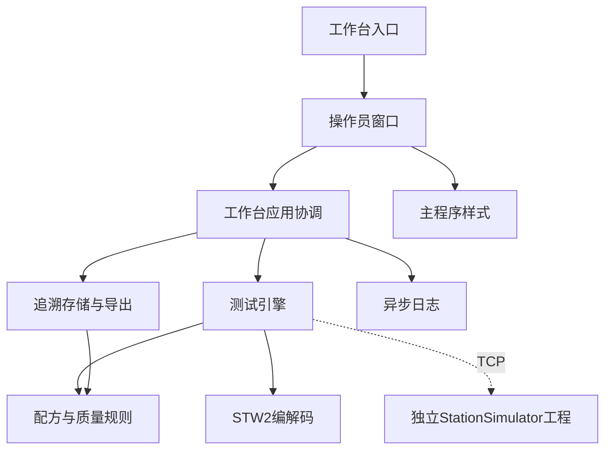

# 业务分包与独立项目

工作台与模拟器是两个同级工程，生产代码仅在运行时通过 TCP 通信：

```text
D:/demoqt6/
├─ StationTestWorkbench/          操作员测试与质量追溯
│  ├─ CMakeLists.txt             仅构建 StationTestWorkbench
│  ├─ src/
│  │  ├─ apps/workbench/         主程序入口
│  │  ├─ testing/                配方、身份、质量判定、工位端点、测试状态机
│  │  ├─ traceability/            单数据库线程、事务、恢复、查询与导出
│  │  ├─ workbench/application/   业务协调与线程生命周期
│  │  ├─ workbench/ui/            主窗口与工位/步骤/历史/日志模型
│  │  └─ shared/                 通信帧、异步日志、主程序界面样式
│  ├─ tests/                     7组独立测试及可选联调
│  └─ scripts/                   主程序验证、启动、部署与可选联合演示
└─ StationSimulator/              独立模拟工位工程
   ├─ CMakeLists.txt             构建 StationSimulator
   ├─ src/
   │  ├─ main.cpp                图形/后台模式入口
   │  ├─ simulation/device/       TCP、模拟执行、状态持久化
   │  ├─ simulation/application/  控制器与设备线程
   │  ├─ simulation/ui/           模拟器窗口
   │  ├─ simulation/stationoptions.h
   │  ├─ contracts/              独立配方/身份校验
   │  ├─ transport/              独立 STW2 编解码
   │  └─ presentation/            模拟器样式
   ├─ tests/                     4组独立测试
   └─ scripts/                   独立验证、启动与部署
```

## 编译依赖

工作台默认不查找或编译模拟器。模拟器自己的源码、CMake、测试也不引用工作台源码，Qt 依赖为 Core、Network、Widgets，无 SQLite/Qt Sql 依赖。



工作台内部仍按业务包维护 CMake 目标：`WorkbenchDomain`、`WorkbenchTesting`、`WorkbenchStorage`、`WorkbenchApplication`、`WorkbenchWidgets`，以及公共协议、日志和样式。`TestEngine` 不引用窗口、控制器或数据库；`WorkbenchApplication` 负责连接数据库、网络及日志工作线程。

模拟器使用自己的 `SimulatorDomain`、`SimulatorProtocol` 和样式目标，并提供 `StationSimulation`、`StationSimulationApplication`、`StationSimulationWidgets`。独立命名空间避免可选联调时与主程序契约实现发生链接符号冲突。两工程的帧格式、JSON字段及配方规则保持一致，跨项目回归验证互通。

## 测试归属

| 位置 | 默认执行的测试 |
|---|---|
| 工作台 `tests/shared/` | ProtocolTests、LoggerTests |
| 工作台 `tests/testing/` | DomainTests、WorkflowTests |
| 工作台 `tests/traceability/` | RepositoryTests、历史查询基准 |
| 工作台 `tests/workbench/` | ModelTests、WindowTests（独立异常SN导出交互） |
| 工作台 `tests/integration/` | 可选 WindowSimulatorTests、SimulatorWindowTests、ProcessTests |
| 模拟器 `tests/` | SimulatorDomainTests、SimulatorProtocolTests、SimulatorTests、SimulatorPanelTests |

工作台独立测试中的网络故障对端由测试夹具提供，不要求真实模拟器。跨项目联调通过 `WORKBENCH_ENABLE_SIMULATOR_TESTS=ON` 启用，`STATION_SIMULATOR_SOURCE_DIR` 指向另一工程；只有该模式会导入外部模拟器库及可执行目标。测试工作目录和可执行输出仍在构建目录顶层，四进程测试在该目录定位模拟器。

## 日常使用

- Qt Creator 分别打开两个根目录的 `CMakeLists.txt`，各自选择 Qt 6 套件构建。
- 主程序使用 `启动主程序.cmd`，模拟器使用另一工程的 `启动模拟器.cmd`。
- 两工程分别执行自己的 `scripts/verify.ps1` 和 `scripts/package.ps1`。
- 工作台 `scripts/verify.ps1 -WithSimulator` 执行可选联调；默认寻找同级模拟器，也可传入 `-SimulatorSourceDirectory`。
- 源码目录保留可选联合演示脚本，默认从同级模拟器构建目录找程序；其他布局通过 `-SimulatorProgramDirectory` 指定。

源码拆分不迁移用户运行数据。主程序继续使用原客户端数据目录，旧模拟工位状态仍留在原位置，新模拟器可通过 `--data-dir` 或启动脚本参数继续使用。
