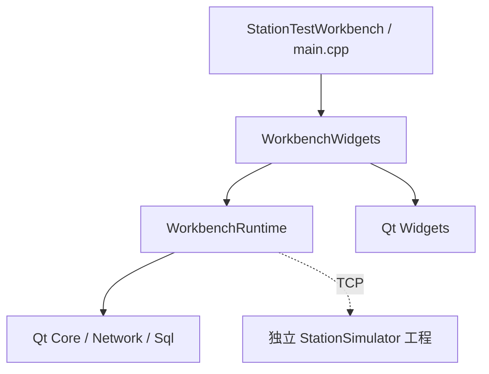

# 目录与业务职责

工作台沿用同级温湿度项目 `Qwenshiducaiji` 的目录风格：源码平铺在根目录，测试平铺在 `tests/`，根 `CMakeLists.txt` 统一管理运行逻辑、界面、入口和测试。业务职责由文件和类区分，不再按多层目录拆出多个小库。

```text
D:/demoqt6/
├─ Qwenshiducaiji/                温湿度项目，保持原样
├─ StationTestWorkbench/
│  ├─ CMakeLists.txt             WorkbenchRuntime、WorkbenchWidgets、主程序和测试
│  ├─ main.cpp                  操作员主程序入口
│  ├─ domain.h/.cpp             配方、身份校验及质量判定
│  ├─ stationendpoint.h         工位连接配置值类型
│  ├─ framecodec.h/.cpp         STW2通信帧
│  ├─ asyncfilelogger.h/.cpp    有界异步文件日志
│  ├─ testengine.h/.cpp         网络执行状态机
│  ├─ repository.h/.cpp         SQLite事务、恢复、历史与导出
│  ├─ workbenchcontroller.h/.cpp 应用协调与线程生命周期
│  ├─ mainwindow.h/.cpp         操作员主窗口
│  ├─ models.h/.cpp             工位、步骤、历史及日志模型
│  ├─ toolstyle.h               界面样式
│  ├─ tests/                    平铺的独立测试、可选联调和历史查询基准
│  ├─ scripts/                  验证、启动、打包和可选联合演示
│  ├─ docs/                     架构、契约及验证记录
│  └─ recipes/                  演示配方
└─ StationSimulator/             独立模拟工位工程
   ├─ CMakeLists.txt             独立构建 StationSimulator
   ├─ src/                      设备、控制器、窗口、契约、协议与样式
   ├─ tests/                    4组独立测试
   └─ scripts/                  独立验证、启动与打包
```

## 构建分层

| 温湿度项目 | 工作台 | 职责与依赖 |
|---|---|---|
| SensorRuntime | WorkbenchRuntime | 配方规则、通信帧、日志、测试引擎、数据库和应用协调；依赖 Qt Core、Network、Sql |
| SensorWidgets | WorkbenchWidgets | 主窗口、表格模型和样式；依赖 WorkbenchRuntime、Qt Widgets |
| Qwenshiducaiji / main.cpp | StationTestWorkbench / main.cpp | 创建应用、解析启动参数并打开窗口 |
| tests/，由根 CMake 定义 | tests/，由根 CMake 定义 | 复用对应库进行业务及界面验证 |



`TestEngine` 的实现仍只处理测试业务与网络，不引用窗口、控制器或数据库。`WorkbenchController` 创建并连接网络、数据库及日志工作线程。归入一个运行逻辑库不改变线程归属、事务顺序或业务接口。

工作台默认不查找或编译模拟器。模拟器的源码、CMake、独立测试不引用工作台源码，依赖 Qt Core、Network、Widgets。两工程分别维护配方契约、STW2编解码和样式；模拟器命名空间 `SimulatorDomain`、`SimulatorWire`、`SimulatorStyle` 避免可选联调时发生符号冲突。

## 测试导航

所有工作台测试源文件位于同一个 `tests/` 目录：

| 文件 | 构建目标及内容 |
|---|---|
| test_domain.cpp | DomainTests：配方、身份与判定规则 |
| test_protocol.cpp | ProtocolTests：帧编解码与错误恢复 |
| test_logger.cpp | LoggerTests：异步写入、限流与退出 |
| test_repository.cpp | RepositoryTests：事务、恢复、历史和异常SN导出 |
| test_workflow.cpp | WorkflowTests：真实TCP、故障恢复、归档确认与批量流程 |
| test_models.cpp | ModelTests：表格模型和显示 |
| test_window.cpp | WindowTests：独立异常SN导出交互 |
| test_window_simulator.cpp | 可选 WindowSimulatorTests：工作台与模拟设备联调 |
| test_simulator_window.cpp | 可选 SimulatorWindowTests：两个窗口与配方预览联调 |
| test_process.cpp | 可选 ProcessTests：四个独立模拟工位进程 |
| benchmark_history.cpp | HistoryBenchmark：独立历史查询基准，不注册为CTest回归 |

七组默认测试使用自己的临时数据库和网络夹具，不要求模拟器源码。跨项目联调通过 `WORKBENCH_ENABLE_SIMULATOR_TESTS=ON` 启用，`STATION_SIMULATOR_SOURCE_DIR` 指向另一工程；只有该模式导入外部模拟器目标。测试与程序输出位于构建目录顶层，保留启动脚本和进程测试的定位方式。

## 日常使用

- Qt Creator 打开工作台根目录的 `CMakeLists.txt`，源码直接显示在项目下。模拟器分别打开自己的根 CMake。
- 主程序使用 `启动主程序.cmd`，模拟器使用另一工程的 `启动模拟器.cmd`。
- 两工程分别执行自己的 `scripts/verify.ps1` 和 `scripts/package.ps1`。
- 工作台 `scripts/verify.ps1 -WithSimulator` 执行可选联调，默认寻找同级模拟器，也可传入 `-SimulatorSourceDirectory`。
- 源码中的可选联合演示通过 `-SimulatorProgramDirectory` 支持其他程序位置。

源码目录调整不迁移运行数据。主程序继续使用原客户端数据目录，旧工位状态仍留在原位置。构建目录、IDE本地设置、密钥、数据库和发布包不进入源码提交。
